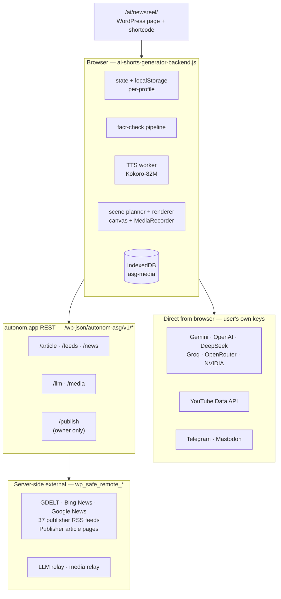

# Autonom Newsreel — Developer Documentation

**Version documented:** v1.28.2
**Audience:** a developer picking this up cold, or a future you in six months.
**Scope:** reference, not tutorial. Assumes you can read JavaScript, PHP, and a REST spec, and that you have not seen this codebase before.

## Contents

1. [Overview](#1-overview)
2. [Architecture](#2-architecture)
3. [File structure](#3-file-structure)
4. [REST API reference](#4-rest-api-reference)
5. [Data model](#5-data-model)
6. [The fact-checking pipeline](#6-the-fact-checking-pipeline)
7. [The AI provider layer](#7-the-ai-provider-layer)
8. [The video pipeline](#8-the-video-pipeline)
9. [Configuration](#9-configuration)
10. [Security and privacy](#10-security-and-privacy)
11. [Debugging](#11-debugging)
12. [Known limitations and failure modes](#12-known-limitations-and-failure-modes)
13. [Changelog](#13-changelog)
14. [Roadmap (not shipped)](#14-roadmap-not-shipped)

---

## 1. Overview

Autonom Newsreel is a browser-resident tool that turns a news article into a finished vertical short video. It is delivered as a WordPress shortcode (`[autonom_newsreel]`) that renders a JS application into a page. The JS application owns all state, all fact-checking, all video assembly, and all platform caption writing. A small WordPress REST API on the same site handles three things the browser cannot do alone: fetching publisher article text (most publisher pages are CORS-blocked), searching news aggregators server-side (same CORS problem plus robots and rate limits), and relaying AI provider calls when a provider refuses a browser origin. There is no Autonom account, no Autonom database, and no Autonom log of what a user does. The tool runs on the user's own API keys, in the user's own browser, on the user's own hardware.

---

## 2. Architecture

The tool has three layers: a browser-resident JS engine, a small WordPress REST relay, and the external providers each layer talks to.



ASCII fallback (for viewers that do not render Mermaid):

```text
┌──────────────────────────────────────────────┐
│ WordPress page: /ai/newsreel/ + shortcode    │
└──────────────────────┬───────────────────────┘
                       │ serves HTML
                       ▼
┌──────────────────────────────────────────────┐
│ BROWSER — ai-shorts-generator-backend.js     │
│  • state + localStorage (per-profile)        │
│  • fact-check pipeline (extract → audit)     │
│  • TTS worker (Kokoro-82M, in-browser)       │
│  • scene planner + renderer                  │
│  • IndexedDB "asg-media"                     │
└────┬───────────────┬────────────────┬────────┘
     │               │                │
     │ direct        │ same-origin    │ client-side
     │ (user key)    │ POST           │ only
     ▼               ▼                ▼
┌─────────────┐ ┌──────────────┐ ┌──────────────┐
│ Providers   │ │ autonom.app  │ │ TTS · render │
│ Gemini      │ │ REST         │ │ ZIP · IDB    │
│ OpenAI      │ │ /wp-json/    │ │ (no network) │
│ DeepSeek    │ │ autonom-asg/ │ └──────────────┘
│ YouTube     │ │ v1/*         │
│ Telegram    │ └──────┬───────┘
│ Mastodon    │        │ server-side
│ Groq        │        ▼
│ OpenRouter  │ ┌──────────────────────────────┐
│ NVIDIA      │ │ External (wp_safe_remote_*)  │
└─────────────┘ │ GDELT · Bing · Google News   │
                │ 37 publisher RSS feeds       │
                │ Publisher article pages      │
                │ LLM relay · media relay      │
                └──────────────────────────────┘
```

### Every outbound call, and where it goes

| From | To | When | Carries | Has user key? |
|---|---|---|---|---|
| Browser | `https://generativelanguage.googleapis.com` | `callGemini` — every Gemini LLM call and model discovery | Prompt + API key in `x-goog-api-key` header | Yes |
| Browser | `https://api.openai.com`, `https://api.deepseek.com` | `callOpenAICompat` — OpenAI and DeepSeek | Prompt + `Authorization: Bearer <key>` | Yes |
| Browser | `https://www.googleapis.com/youtube/v3` | `ytFetch` — channel derivation, video stats for virality | Query + `key=` param | Yes |
| Browser | `https://api.telegram.org` | `tgPost` — direct Telegram video post | Multipart body + bot token in URL path | Yes |
| Browser | `https://<instance>/api/v2/media`, `/api/v1/statuses` | `mastoPost` — direct Mastodon video post | Multipart body + `Authorization: Bearer` | Yes |
| Browser | `https://api.groq.com`, `https://openrouter.ai`, `https://integrate.api.nvidia.com` | `compatSend` — first attempt at these three providers | Prompt + `Authorization: Bearer` | Yes |
| Browser (CORS proxy, first fallback only) | `https://api.allorigins.win`, `https://api.codetabs.com`, `https://api.rss2json.com` | `tryFeed` — only when server news and GDELT have both failed | RSS URL | No |
| Browser → Site REST | `/wp-json/autonom-asg/v1/news?q=...` | `fetchServerNews` — every Feed scan | Search query, session cookie for rate-limit identity | No (server handles) |
| Browser → Site REST | `/wp-json/autonom-asg/v1/feeds?q=...` | `fetchPublisherFeeds` and `fetchFeedItems` — every scan and every corroboration | Search terms | No |
| Browser → Site REST | `/wp-json/autonom-asg/v1/article?url=...` | `fetchArticle` — every story a script is being written from, and every candidate second-outlet article | Article URL | No |
| Browser → Site REST | `/wp-json/autonom-asg/v1/llm` | `compatSend` via `listViaRelay` or `viaRelay` — only when a direct call to Groq, OpenRouter, or NVIDIA failed with a CORS or network error, or when a model list refused a browser origin | Provider name + key + payload | **Yes** (relayed, not stored) |
| Browser → Site REST | `/wp-json/autonom-asg/v1/media?u=...` | `mediaFetch` — only when a direct Pexels or Pixabay call failed | Media URL + optional `X-Asg-Auth` header for Pexels | **Yes** (Pexels relay, not stored) |
| Browser → Site REST | `/wp-json/autonom-asg/v1/publish` | `pubSend` — owner-only hand-off, capability-gated | Multipart: `meta` JSON + optional video Blob | No (uses WP nonce) |

The user's AI keys go to the provider they chose, in the user's browser, except in the two cases marked **Yes** where the request is relayed through the site server because the provider refuses a browser origin. In those two cases the key is passed through and not stored or logged — see §10 for the verification path.

### Why the browser owns so much

The tool could have been a server-side application. It is not, for three reasons:

1. **Cost.** A server-side TTS pipeline costs money per character; the browser's is free. A server-side render costs server CPU; the browser's is free. A server-side pipeline also has to store every user's scripts, videos, and keys, which is a liability nobody asked for. Keeping the tool client-side is what makes it free to run and honest about privacy.
2. **Security.** Keys live in `localStorage` on the user's machine, not in an Autonom database. That is a smaller liability than a shared key server. It is also honest: the user can open DevTools and verify exactly what is sent where.
3. **Latency and offline.** The voice, the render, the ZIP export, and the caption generation all run locally. Once the model is downloaded, a user can make a video on a plane if they already have their facts.

The cost of that choice is that some things must live on the server: the CORS-blocked publishers, the aggregator searches, and the fallback relay for providers that refuse browser origins. Everything else is in the browser on purpose.

---

## 3. File structure

Four files matter. Their paths depend on how the tool was deployed (plugin vs. WPCode + uploads directory).

| File | What it is | Scope | Where it lives | Approx. size |
|---|---|---|---|---|
| `ai-shorts-generator-tool-style.css` | Page-level CSS | `.autonom-page`, `.autonom-guide` | `/wp-content/uploads/autonom/ai-shorts-generator/` (unless overridden by `AUTONOM_ASG_ASSETS_URL`) | ~13 KB, ~450 lines |
| `ai-shorts-generator-backend.js` | The entire JS engine | `window.__autonomASGLoaded` guard, IIFE | Same uploads folder | ~200 KB, ~4,500 lines |
| The PHP shortcode file | Shortcode + REST endpoints + inline `<style id="asg-tool-style">` | `.asg-root`, `.asg-modal` | Pasted into WPCode, or a plugin file | ~40 KB, ~800 lines |
| `product/newsreel/doc/product.md` | Product documentation | (None — Markdown) | Repo only | — |

### Which file is canonical for styles?

**Neither is deprecated. Both are live and scoped to different things.**

- `ai-shorts-generator-tool-style.css` is the **page-level** stylesheet. It defines `.autonom-page`, `.autonom-hero`, `.autonom-section`, `.autonom-guide`, `.autonom-cta-box`, `.autonom-related-list`, `.autonom-callout`, and the guide classes. It is enqueued by `autonom_asg_register_assets()` on `wp_enqueue_scripts`, and the shortcode calls `wp_enqueue_style('autonom-asg-tool')` when it renders. If you delete this file, the tool still works — the tool's own UI is styled by the inline block — but the marketing page around it loses its layout and the guide pages lose their typography.

- The inline `<style id="asg-tool-style">` block inside `autonom_asg_shortcode()` is the **tool-level** stylesheet. It defines `.asg-root` and everything inside it: the topbar, step rail, panels, mode cards, story list, script cards, video boxes, publish cards, settings drawer, and the `.asg-modal` overlay that sits outside `.asg-root` but carries its own token set. It is inline because (a) the tool's UI is ~1,500 lines and there is no reason to add a network round-trip for it, (b) it must load even if the uploads folder is not writable and the CSS file 404s, and (c) it is the same on every page that uses the shortcode, so the browser caches it with the HTML.

The two stylesheets never collide because they are scoped to different wrappers. The only place they interact is the `.autonom-page` wrapper (page-level) containing an `.asg-root` (tool-level). The page wrapper styles the margins, the background, and the max-width. The tool's own CSS styles the interior. If you are editing a class and unsure which file to touch: if the class starts with `.asg-`, it belongs in the inline style block; if it starts with `.autonom-`, it belongs in the CSS file.

### Cache busting

`autonom_asg_asset_ver()` (in the PHP file) returns the file's `filemtime()` when the file can be located on disk. It falls back to `AUTONOM_ASG_VERSION` when it cannot. If you edit the CSS or JS without bumping the version, the cache-buster still works as long as the file lives in the uploads folder the PHP is reading from. If you move the file to a plugin folder and `plugin_dir_url()` no longer resolves correctly, you get the version string as the cache-buster, which is why you should bump `AUTONOM_ASG_VERSION` on every deploy of the JS.

### Enqueue path

`autonom_asg_register_assets()` runs on `wp_enqueue_scripts` priority 5:

```php
wp_register_style( 'autonom-asg-tool', $base . 'ai-shorts-generator-tool-style.css', array(), autonom_asg_asset_ver( 'ai-shorts-generator-tool-style.css' ) );
wp_register_script( 'autonom-asg-backend', $base . 'ai-shorts-generator-backend.js', array(), autonom_asg_asset_ver( 'ai-shorts-generator-backend.js' ), true );
```

`$base` is `AUTONOM_ASG_ASSETS_URL` when defined, otherwise `plugin_dir_url( __FILE__ )`. Neither file is enqueued globally — the shortcode calls `wp_enqueue_style()` and `wp_enqueue_script()` on render, so pages that do not include the shortcode do not load the 200 KB JS.

### `wp_localize_script` object shape

The shortcode localizes `AUTONOM_ASG` once per page (guarded by the `$localized` static):

```js
window.AUTONOM_ASG = {
  version: '1.28.2',
  articleEndpoint: 'https://autonom.app/wp-json/autonom-asg/v1/article',
  newsEndpoint:    'https://autonom.app/wp-json/autonom-asg/v1/news',
  feedsEndpoint:   'https://autonom.app/wp-json/autonom-asg/v1/feeds',
  llmEndpoint:     'https://autonom.app/wp-json/autonom-asg/v1/llm',
  mediaEndpoint:   'https://autonom.app/wp-json/autonom-asg/v1/media',
  publishEndpoint: 'https://autonom.app/wp-json/autonom-asg/v1/publish',
  canPublish:      false,   // true only if current user can upload_files
  restNonce:       '<wp_rest nonce>'
};
```

The JS reads this object as `cfg = window.AUTONOM_ASG || {}` and treats every endpoint as optional: if `cfg.articleEndpoint` is missing, `fetchArticle()` returns `null` and the pipeline treats every story as unreadable, which makes the tool headline-only. That is the fallback path when the shortcode is deployed without the PHP that registers the REST routes.

---

## 4. REST API reference

Six endpoints, all under `autonom-asg/v1`. All registered by `autonom_asg_register_rest()` on `rest_api_init`. Every endpoint has a `permission_callback`. Five are `__return_true`; one is `autonom_asg_can_publish`.

### `GET /wp-json/autonom-asg/v1/article?url=<article_url>`

**Purpose.** Fetch and extract the readable article text from a publisher page. This is what every fact extraction and every second-outlet comparison reads from.

**Auth.** None. Rate-limited per IP.

**Inputs.** `url` (string, required). Must pass `esc_url_raw()` and `wp_http_validate_url()` — a rejected URL returns `400 bad_url`.

**Outputs.**

```json
{
  "ok": true,
  "title": "…",
  "text": "…",
  "length": 4128,
  "host": "reuters.com",
  "finalUrl": "https://www.reuters.com/world/…"
}
```

On failure: `{ "ok": false, "error": "bad_url" | "rate_limited" | "fetch_failed" | "http_403" | "not_html" | "empty" | "too_short" | "paywalled" | "decode_failed" | "redirect_link" }` with a matching HTTP status (429 for `rate_limited`, 400 for `bad_url`, otherwise 200 with the error in body — the JS reads `j.error` regardless of status).

**Hardening.**

- `wp_safe_remote_get()` refuses private and loopback addresses and non-standard ports. This is the SSRF protection; do not replace it with `wp_remote_get()`.
- The `limit_response_size` is 1,500,000 bytes. A page that returns more is truncated, not refused.
- The `Accept` header prefers HTML. A `Content-Type` that does not contain `html` returns `not_html`.
- Two user agents are tried: a bot UA first (identified, honest), then a plain desktop Chrome UA if the response is 401/403/406/429/503. This is what gets past publishers that block unrecognised bots.
- Cache: 6 hours per URL, keyed by `md5($url)`. Saves a re-fetch when the same article is opened multiple times (common during Generate — extraction, verify, audit all read the same article from cache).

**Rate limits.**

- 90 requests per 10 minutes per IP.
- 400 requests per hour globally.

**Google News resolver.** If the URL host is `news.google.com`, `autonom_asg_decode_gnews()` is called first. Google wraps every article URL behind a redirect, and the real URL is hidden inside a signature-protected page. The function does two things: (1) fetches the Google News article page to extract `data-n-a-sg` and `data-n-a-ts`, (2) POSTs a `batchexecute` request with those values, and parses the response to extract the real publisher URL. The decoded URL is cached for 12 hours. This uses undocumented Google internals — it can break without warning, and it sometimes blocks server IPs. Treat it as best-effort: if decoding fails, return `decode_failed` and let the JS fall back to another outlet.

**Paywall handling.** If the extracted text is under 1,500 characters and contains any of a set of paywall phrases (`subscribe to continue`, `sign in to continue`, `to continue reading`, etc.), the endpoint returns `paywalled` rather than the truncated text. There is also a hardcoded blocklist (`wsj.com`, `ft.com`, `bloomberg.com`, `economist.com`, `barrons.com`) that refuses without trying — these are 100% paywalled and a fetch wastes a request.

**Bing News resolver.** If the URL host is `bing.com`, the endpoint returns `redirect_link` rather than following the redirect. Bing's redirect URLs are not decoded here; the JS treats `redirect_link` as a signal to skip.

### `GET /wp-json/autonom-asg/v1/feeds?q=<term> OR <term> OR …`

**Purpose.** Fetch all publisher feeds in the registry, filter to items matching the search terms, and return recent items plus per-feed stats.

**Auth.** None.

**Inputs.** `q` (string, optional). If empty, returns all recent items from every feed. Terms are split on the word `OR`, sanitised to word characters and spaces, deduped, and capped at 24.

**Outputs.**

```json
{
  "ok": true,
  "items": [
    { "title": "…", "link": "https://…", "pubDate": "2026-10-27T10:00:00+00:00",
      "author": "BBC News", "description": "…", "readable": "open",
      "feed": "bbc-world", "hits": 2 }
  ],
  "stats": [
    { "id": "bbc-world", "access": "open", "ok": true, "code": 200,
      "count": 40, "matched": 3, "error": "" }
  ]
}
```

**Feed registry.** `autonom_asg_feed_registry()` returns ~37 feeds. Each entry has `id`, `name`, `access` (`open` / `metered` / `paywalled`), and `url`. `access` is what the JS uses to decide whether a story can be a script source: `open` articles are read directly, `metered` are attempted (with a fallback to an open outlet if they hit a paywall), `paywalled` are topic signals only. The registry is filterable via `apply_filters('autonom_asg_feeds', $list)` — the extension point for adding a feed without touching the file.

**Feed fetch.** `autonom_asg_multi_get()` uses `WpOrg\Requests\Requests::request_multiple` (bundled with WordPress) to fetch all feeds in parallel, with a fallback to sequential `wp_safe_remote_get()` if the Requests library is unavailable. A per-feed transient caches the result for 10 minutes (2 minutes on failure). This is why a scan of 37 feeds returns in a few seconds instead of a few dozen round-trips.

**Parser.** `autonom_asg_parse_feed()` handles RSS 2.0, RSS 1.0 (RDF), and Atom. It walks the item/entry elements by local name, so namespaces do not break it. It caps at 40 items per feed to avoid a giant feed blowing up the response.

**Item matching.** `autonom_asg_term_hits()` uses a word-boundary regex (`\p{L}\p{N}` boundaries) per term. It is not fuzzy; it matches the term as a word. Items older than 5 days are dropped. Duplicate links (same URL after `md5`) are collapsed.

**Sorting.** Items are sorted by `hits` descending, then `pubDate` descending. That is what makes a multi-signal profile (`missile OR sanctions`) surface the stories that hit multiple signals first.

**Rate limit.** 80 requests per 10 minutes per IP.

### `GET /wp-json/autonom-asg/v1/news?q=<term> OR <term>`

**Purpose.** Search for recent news across aggregators (not publisher feeds). This is the search path that runs before any feed is considered, and it is what populates the "aggregator" side of the story list.

**Auth.** None.

**Inputs.** `q` (string, required). Same term parsing as feeds.

**Outputs.**

```json
{ "ok": true, "source": "gdelt" | "bing" | "google", "items": [ … ] }
```

Each item has the same shape as a feed item, plus `redirect: true|false`. Google News items are `redirect: true` (they need the `/article` resolver); GDELT and Bing are `redirect: false` because they return the real publisher URL in the aggregator response.

**Chain.** GDELT → Bing News RSS → Google News RSS. First chain link that returns any items wins. The GDELT query is `(<terms>) sourcelang:english` with `maxrecords=30`, `sort=hybridrel`, `timespan=2d`. GDELT sometimes returns plain text error responses (rate limit, malformed query) — the parser checks that the body starts with `{` and returns empty on any other body, then falls to the next chain link.

**Cache.** 10 minutes per term set (`md5(implode('|', $terms))`).

**Rate limit.** 60 requests per 10 minutes per IP.

**Why a chain and not all three in parallel?** Because GDELT is fast and generous when it works, Bing is a reliable fallback, and Google News is the last resort because every item requires the `/article` resolver call. Doing all three at once is three times the upstream load for one win. The chain ends the moment it has results.

### `POST /wp-json/autonom-asg/v1/llm`

**Purpose.** Relay a chat-completions request to Groq, OpenRouter, or NVIDIA when the browser cannot call them directly. The browser makes the first attempt directly; this endpoint is the fallback.

**Auth.** None (anyone can POST). The `provider` field is checked against a fixed allowlist, and the `key` field is checked against a format regex. There is no user identity here — the endpoint trusts the caller for the key only.

**Inputs.**

```json
{ "provider": "groq" | "openrouter" | "nvidia",
  "key": "<user's API key>",
  "payload": { "model": "…", "messages": […], … },
  "action": "models" | null }
```

`action: "models"` switches the endpoint to a `GET /models` call (used by model discovery when a direct call was refused), with the same auth pattern.

**Outputs.**

```json
{ "ok": true, "status": 200, "text": "<upstream response body as string>" }
```

The `text` is passed through unchanged so the JS can parse it the same way it parses a direct response. The `status` is the upstream status, so the JS can branch on 401/403/429/500 the same way for direct and relayed calls.

**Hardening.**

- Provider allowlist: only the three keys above are accepted.
- Key regex: `^[A-Za-z0-9_\-\.]+$`, max 300 chars. This is a format check, not a validation — the provider is the validator.
- Payload must be an array, `wp_json_encode()`d, and under 120,000 bytes.
- Rate limit: 150 requests per 10 minutes per IP.

**Key storage.** None. The key is in memory for the duration of the request and is not written to a transient, option, or log. If you see the key in a WordPress debug log, that is a bug — see §10.

### `GET /wp-json/autonom-asg/v1/media?u=<url>`

**Purpose.** Relay a stock library API call or a stock clip download when the browser's direct call was CORS-blocked. Pexels in particular refuses some browser origins; Pixabay is more permissive but still sometimes blocked.

**Auth.** None. The `X-Asg-Auth` header from the browser carries the Pexels key for Pexels requests; the endpoint passes it on as `Authorization`. For Pixabay, no auth is needed on the proxy (Pixabay keys go in the query string, which the JS puts there before calling).

**Inputs.** `u` (string, required). Must be HTTPS, must be one of `api.pexels.com`, `videos.pexels.com`, `images.pexels.com`, `pixabay.com`, `cdn.pixabay.com`. Anything else returns `400 bad_request`.

**Outputs.** The proxied response body with its original `Content-Type`, `Cache-Control: private, max-age=3600`, `X-Content-Type-Options: nosniff`. The endpoint writes to `php://output` and exits; it does not use `WP_REST_Response` because the body is a binary or JSON blob that should not go through WordPress's JSON encoder.

**Hardening.**

- Host allowlist: only the five hosts above. This blocks SSRF through the relay.
- `Content-Type` must match `application/json`, `video/*`, or `image/*`. Anything else returns `415 unsupported_type`.
- Size cap: `limit_response_size` is 30,000,000 bytes. A larger response returns `413 too_large`.
- Rate limit: 300 requests per 10 minutes per IP.

### `POST /wp-json/autonom-asg/v1/publish`

**Purpose.** Owner-only hand-off. The browser sends a finished video and a metadata JSON blob; the endpoint stores the video at a public unguessable URL, forwards the metadata (plus the video URL) to the owner's own webhook (Make, n8n, Zapier), and returns the webhook's response. The video is deleted after 3 days by a scheduled cleanup.

**Auth.** `permission_callback => 'autonom_asg_can_publish'`, which is `is_user_logged_in() && current_user_can('upload_files')`. Ordinary visitors of the free browser tool cannot reach this endpoint.

**Status.** Implemented and capability-gated, but **not production-tested**. The endpoint should not be documented as available to users until every item on the test list below passes.

**Test list** (run before documenting as available):

- Valid webhook returning 200 → `ok: true`, `webhook_status: 200`.
- Invalid webhook (`http://`, private IP, malformed) → `400 webhook_invalid`.
- Oversized video upload → `413 upload_failed` with the correct message.
- Non-video file extension → `415 bad_type`.
- Video URL is public and unguessable.
- `X-Newsreel-Secret` header arrives on the webhook when a secret is set.
- File older than 3 days is deleted on the next publish request.
- Unauthenticated user → `403 rest_forbidden`.

**Inputs.** Multipart form:

- `meta` (string, required) — a JSON object with `event`, `webhook`, `secret`, `profile`, `platforms`, `scheduled_at`, `scheduled_local`, `timezone`, `title`, `description`, `tags`, `posts`, `pinned_comment`, `sources`, `duration_sec`, `captions_srt`.
- `video` (file, optional) — a `mp4`, `webm`, or `mov` file. Required unless `meta.test` is true.

**Outputs.**

```json
{ "ok": true, "webhook_status": 200, "webhook_reply": "ok", "video_url": "https://…/autonom-newsreel/<random>.mp4" }
```

On error: `{ "ok": false, "error": "bad_request" | "webhook_invalid" | "no_video" | "upload_failed" | "bad_type" | "no_storage" | "webhook_failed", "message": "…" }`.

**Hardening.**

- `webhook` must start with `https://` and pass `wp_http_validate_url()`. HTTP and private addresses are refused.
- `video` extension must be one of `mp4`, `webm`, `mov`. Anything else returns `415`.
- Video is stored in `wp-content/uploads/autonom-newsreel/<24-hex>.<ext>` with a random name and no directory index.
- Webhook forwarding is `wp_safe_remote_post()` with a 25-second timeout and an `X-Newsreel-Secret` header when a secret was provided.
- The response includes the webhook's HTTP status and the first 300 bytes of its body, so the caller can debug a failing automation without checking Make/n8n logs.

**Video storage.** `autonom_asg_publish_dir()` returns `{dir, url}`. If the uploads folder is not writable, it returns `null` and the endpoint returns `500 no_storage`. The folder is protected only by the random filename. If you deploy this in production, add an empty `index.html` and a directory-listing deny rule to the `autonom-newsreel` folder.

**Cleanup.** `autonom_asg_publish_cleanup()` runs at the top of every publish request and deletes files older than 3 days (`259200` seconds). There is no WP-Cron task for this; the cleanup is opportunistic on the next publish. If you need a guaranteed cleanup on a quiet server, register a cron.

---

## 5. Data model

Everything below is the exact shape the JS writes. Field names matter because they cross the localStorage / IndexedDB boundary and the JSON manifest.

### The profile object

Created by `deriveFromTexts()` (manual setup or YouTube derivation). Stored at `localStorage['autonom.asg.profiles.v1']` as `{active, list: [...]}`, and the active one is also at `localStorage['autonom.asg.profile.v1']`.

```js
{
  schemaVersion: '1.0',
  id: 'tp_<base36>',
  name: 'Blomstra Insights',
  createdAt: '2026-10-27T10:00:00.000Z',
  updatedAt: '2026-10-27T10:00:00.000Z',
  source: {
    mode: 'manual' | 'youtube',
    channelId?: 'UC…',
    channelHandle?: '@…',
    language: 'en'
  },
  identity: {
    oneLiner: 'Geopolitics × macroeconomy × tech',
    positioning: '…',
    audienceHint: '…',
    dna: 'Voice: …\nStance: …\nSignature: …\nNever: …',
    samples: { titles: [ '…' ], top: [ '…' ] } | null
  },
  topics: [
    { name: 'Geopolitics', weight: 0.5, subtopics: [ '…' ], signals: [ 'missile', 'sanctions', 'NATO' ] }
  ],
  tone: {
    style: 'analytical',
    energy: 'urgent',
    formality: 'neutral-brief',
    pov: 'analyst',
    avoid: [ 'clickbait hyperbole', 'partisan framing' ]
  },
  format: {
    targetDurationSec: 45,
    wordCountMin: 95,
    wordCountMax: 124,
    lengthV2: true,
    structure: [ 'hook', 'what-happened', 'background', 'why-it-matters', 'what-to-watch', 'cta-question' ],
    hookStyle: 'event-first',
    ctaStyle: 'question'
  },
  cadence: { videosPerDay: 2, preferredTimes: [ '09:00', '18:00' ], timezone: 'Europe/Stockholm', minGapHours: 4 },
  constraints: {
    bannedTopics: [], bannedWords: [], bannedSources: [],
    requiredDisclosure: 'AI-assisted analysis. Sources cited in description.',
    sourceCitationRequired: true
  },
  performanceHints: { analyzedVideoCount: 30, avgDurationSec: 58, notes: 'Auto-derived; edit as needed.' },
  promptTemplateId: 'tactical-analysis-v1',
  meta: { lastSyncedAt: '2026-10-27T10:00:00.000Z', derivationMethod: 'youtube-api + heuristic', confidence: 0.72 }
}
```

`format.wordCountMin` and `wordCountMax` are computed by `formatFor(sec)` at 2.5 words per second, ±~13%. `formatFor(60)` returns `{targetDurationSec: 60, wordCountMin: 128, wordCountMax: 165}`. These bounds are what the check at step 6 enforces.

`format.lengthV2` is a one-time migration flag. If a profile was saved before the length rework, `loadState()` runs the format through `formatFor()` and sets `lengthV2: true` so it never runs again.

### The settings object

`state.settings`. Stored per-profile at `localStorage['autonom.asg.settings.v1.<profile_id>']` and mirrored globally at `localStorage['autonom.asg.settings.v1']`. Every key:

```js
{
  // API keys — all user-provided, all in localStorage
  youtubeKey: '',
  llmProvider: 'gemini',            // 'gemini' | 'openai' | 'deepseek' | 'groq' | 'openrouter' | 'nvidia' | 'none'
  geminiKey: '',
  geminiModel: '',
  geminiWriteModel: '',
  openaiKey: '',
  deepseekKey: '',
  groqKey: '', groqModel: '', groqWriteModel: '',
  openrouterKey: '', openrouterModel: '', openrouterWriteModel: '',
  nvidiaKey: '', nvidiaModel: '', nvidiaWriteModel: '',

  // Stock footage
  stockProvider: 'pixabay',
  pixabayKey: '',
  pexelsKey: '',

  // Generation behavior
  requireSecond: false,
  depth: true,
  strategy: 'value',
  writeBest: true,
  fallbackProviders: true,

  // Per-story overrides
  autoLen: true,
  autoLens: true,
  autoHook: true,
  lens: 'between',
  hook: 'event',

  // Video defaults
  video: {
    voice: 'am_echo',
    speed: 1,
    res: '720',
    footage: true,
    engine: 'wasm',
    tag: true,
    callouts: true,
    endcard: true,
    banner: true,
    motion: true
  },

  // Publishing
  publishPlatforms: [ 'youtube', 'instagram', 'facebook', 'tiktok', 'x', 'linkedin', 'telegram' ],
  publishWebhook: '',
  publishSecret: '',
  publishFirst: '',
  publishGap: 6,
  telegramToken: '', telegramChat: '',
  mastodonInstance: '', mastodonToken: '',

  // Disclosure
  madeWith: true
}
```

Every key has a default in `DEFAULT_SETTINGS` (a `JSON.parse(JSON.stringify(state.settings))` copy of the initial object). `loadSettingsFor(id)` does `Object.assign({}, DEFAULT_SETTINGS, stored)` — new keys added to `DEFAULT_SETTINGS` are picked up automatically on next load, so there is no migration step for settings. Keys removed from `DEFAULT_SETTINGS` remain in `stored` and are silently ignored.

### The script object

Created by `scriptFromParsed()` and enriched by every step after generation. Stored at `localStorage['autonom.asg.scripts.v1.<profile_id>']` (array) and mirrored globally.

```js
{
  // Core fields from scriptFromParsed()
  id: 'sc_<base36>',
  storyId: 'st_<base36>',
  storyTitle: '…',
  source: '…',
  url: 'https://…',
  hook: '…', body: '…', analysis: '…', cta: '…',
  title: '…',
  description: '…',
  tags: [ 'Iran', 'geopolitics', '…' ],
  sources: [ 'https://…' ],
  isTemplate: false, reason: '',
  model: 'gemini-2.5-flash',
  provider: 'gemini',
  contextLevel: 'article',
  createdAt: '2026-10-27T10:00:00.000Z',

  // From sourceMeta()
  sourceName: 'Reuters',
  sourceUrl: 'https://…',
  via: 'direct' | 'alternative',
  lens: 'between',
  hookStyle: 'event',
  targetSec: 45,
  analysisOn: true,

  // From the pipeline
  facts: [
    {
      claim: '…',
      quote: '…',
      outlet: 'Reuters',
      status: 'single' | 'confirmed' | 'conflict' | 'possible',
      other: { outlet, quote, note?, quoteUnverified? } | null,
      confirmedBy: [ 'AP' ]
    }
  ],
  corroboration: {
    status: 'none' | 'corroborated' | 'partial' | 'conflict',
    outlet: 'AP',
    outlets: [ 'AP' ],
    url: 'https://…',
    urls: [ 'https://…' ],
    confirmed: 4, total: 6, extra: 2,
    conflicts: [ { claim, outlet, other } ],
    possible: [ { claim, outlet, other } ],
    reason: '…'
  },
  checks: {
    factsVerified: 6,
    factsExtracted: 9,
    badNums: [ '…' ], badTerms: [ '…' ],
    wording: [ '…' ],
    auditRan: true,
    auditFlags: [ { id, type, severity, sentence, problem, fix } ],
    auditError: '',
    words: 118,
    lengthOver: false,
    analysisDropped: 0,
    autoFixed: 0,
    status: 'checked' | 'review',
    revised: false
  },
  hookAlts: [ { style: 'question', text: '…', score: 82, why: [ 'open question' ] } ],
  hookScore: { score: 84, why: [ 'short', 'names who', 'real stakes' ] },
  altTitles: [ { style: 'match' | 'engaging', text: '…' } ],
  pinned: '…',
  banner: '…',
  callouts: [ { text: '45%', at: 'up to 45 percent' } ],
  models: [ { step: 'Facts', provider: 'gemini', model: '…' } ],
  mergedStories: [ { title, url, source } ],

  // From review
  reviewed: false,
  narration: '…',

  // From video
  mediaId: 'm<base36>',
  vplan: { hash: '…', scenes: [ { query, alt, kind } ] },
  schedule: '2026-10-27T16:30',
  published: { at, platforms: [ … ], scheduled_for: '2026-10-27T14:30:00.000Z' },

  // From publish
  posts: { instagram: '…', x: '…', linkedin: '…' }
}
```

`checks.status` is `'checked'` only when every check passed: `factsVerified >= 3`, no `badNums` or `badTerms`, no `lengthOver`, `auditRan === true`, `majorCount(auditFlags) === 0`, `corroboration.status !== 'conflict'`, and no `corroboration.possible` entries. Any failure puts it at `'review'`, which the Review card surfaces in amber.

`scriptWords(sc)` is `wordCount(hook) + wordCount(body) + wordCount(analysis) + wordCount(cta)`. This is what the length check compares against `profile.format.wordCountMax + 12`.

### The media record

Stored in IndexedDB `asg-media`, store `media` (keyPath `id`). Written by `showVideoResult()` after `makeVideo()` returns.

```js
{
  id: 'm<base36>',
  title: '…',
  video: Blob,
  ext: 'mp4' | 'webm',
  mime: 'video/mp4;codecs=…',
  duration: 58.4,
  w: 720, h: 1280,
  audio: Blob,
  srt: '1\n00:00:00,300 --> …',
  credits: [ 'pexels-user-name' ],
  provider: 'Pixabay' | 'Pexels',
  footage: 'stock' | 'plain',
  plain: 0,
  madeAt: '2026-10-27T10:00:00.000Z',
  sceneHash: '…',
  scenes: [
    { text: '…', start: 0.3, usedQuery: 'missile launch', query: '…', alt: '…', kind: 'footage' | 'card' }
  ]
}
```

The `parts` store (keyPath `id`) holds cached voice synthesis:

```js
{
  id: 'm<base36>',
  key: hash(narration + '|' + voice + '|' + speed),
  parts: [ { text: '…', samples: Float32Array, rate: 24000 } ]
}
```

The `key` is what makes "re-record scenes" cheap: if the narration, voice, and speed are unchanged, `makeVideo()` reads the parts from IndexedDB and skips synthesis entirely.

### `buildPayload()` output

What the Export ZIP's `manifest.json` and the "Download JSON" button both produce.

```js
{
  schemaVersion: '1.2',
  generatedAt: '2026-10-27T10:00:00.000Z',
  profile: { …the full profile object… },
  scripts: [
    {
      …everything in the script object except vplan and mediaId…,
      narration: '…',
      media: {
        video: '01-slug/video.mp4',
        audio: '01-slug/voiceover.wav',
        captions: '01-slug/captions.srt',
        upload: '01-slug/upload.txt',
        durationSec: 58,
        resolution: '720x1280',
        footageLibrary: 'Pexels' | null,
        madeAt: '2026-10-27T10:00:00.000Z'
      }
    }
  ]
}
```

The media paths are derived by `mediaPaths(sc, i, rec)` and match the actual file layout the ZIP writer produces. If a script has no `mediaId`, `media` is `null`.

### localStorage keys

All under the `autonom.asg.*` namespace or the `asg_*` prefix.

| Key | What it holds | Scope |
|---|---|---|
| `autonom.asg.profiles.v1` | `{active, list: [profile…]}` | Global |
| `autonom.asg.profile.v1` | Active profile (mirror of one entry in the list) | Global |
| `autonom.asg.settings.v1` | Active profile settings | Global mirror |
| `autonom.asg.settings.v1.<profile_id>` | Settings for a specific profile | Per-profile |
| `autonom.asg.scripts.v1` | Active profile scripts (array) | Global mirror |
| `autonom.asg.scripts.v1.<profile_id>` | Scripts for a specific profile | Per-profile |
| `asg_gone_models` | `{ '<provider>:<model>': <expiry_ts> }` — 6-hour TTL | Global |
| `asg_model_health` | `{ '<provider>:<model>': {f, u, d?} }` — failure count, retry time, daily flag | Global |
| `asg_unusable_v1` | `{ '<clean_url>': {t, why} }` — 24-hour TTL | Global |
| `asg_viral_cache_v1` | `{ '<query>': {t, d} }` — 12-hour TTL | Global |
| `asg_footage_cache` | `{ '<provider>\|<query>': {t, v} }` — 24-hour TTL, max 60 entries | Global |

The `<profile_id>` scoping is why switching profiles does not carry one channel's scripts into another. `scriptsKey(id)` and `settingsKey(id)` are the helpers; both fall back to the global key when `id` is falsy (old single-profile installs).

### IndexedDB: `asg-media`

One database, version 1, opened by `idb()`. Two object stores, both `keyPath: 'id'`:

- `media` — the finished videos and their metadata.
- `parts` — the cached TTS output, per `id`.

On a browser that blocks IndexedDB (private mode in some Safari versions), `dbPut` and `dbGet` fall back to an in-memory `memStore` object. The user can still make and export videos in a single session; they just cannot close the tab and come back to them. This fallback is transparent — `LOG('not saved to browser storage…')` is the only signal.

---

## 6. The fact-checking pipeline

Eleven steps, in the order they run. The naming in this section matches the function names in `ai-shorts-generator-backend.js` so you can `Ctrl+F` from here to there.

> **Warning.** Do not relax these steps without reading the audit prompt in `writePrompt()` (around line ~2400) and the `auditPrompt()` (around line ~1400). The prompts encode years of edge cases. If you find a class of error the pipeline misses, add it to the audit prompt's list first; do not weaken the pipeline to make a script pass.

**Step 1 — `resolveSource(story)`.** Determine the article to read from. Order: the story's own URL (if `readable` is not `paywalled` and not `thin`), then a related story from the same scan, then `searchOpenAlternative()` which searches publisher feeds by headline for an open outlet. Sets `src.art.text`, `src.story`, `src.via` (`direct` or `alternative`). If no readable source is found, the story is gated: a `gatedScript` is created with the reason, and the pipeline ends for that story.

**Step 2 — `extractFactsFor(story, art)`.** The model reads the article and returns 8–12 facts. Each fact has a `claim` and an exact `quote`. If the model returns no facts, the function retries once with a format reminder; if the second retry is also empty, the error gates the story with `retryable: true` so the user can press Retry. The `extractPrompt()` is at ~line 900.

**Step 3 — `verifyFacts(facts, articleText)`.** Mechanical checks in pure JS:

- Drop any fact whose `quote` is under 25 normalised characters (fragment guard).
- Drop any fact whose `claim` starts with a lowercase letter, has unbalanced quote marks, or is under 4 words (fragment guard).
- Speaker check: if the claim starts with `<Name> said/says/…`, the name tokens must appear in the quote. If they do not, the fact is dropped.
- Quote-in-article: normalise whitespace and punctuation of both; the quote must appear as a substring (or, if it contains `…`, every segment ≥20 chars must).
- Facts that pass get `status: 'single'` and `outlet: story.source`.

**Step 4 — `verifyClaims(okFacts)`.** An LLM check on the facts that the code checks flagged as suspicious. The suspicion criteria: `claimStronger()` returns a word, or `numDiff()` shows a number mismatch, or `claimOverlap()` (5-letter stem overlap) is under 0.6. Only those facts go to the model, which returns `{"bad": [{fact, problem}]}`. Bad facts are either replaced with the raw quote (as `claimReplaced: true`) or dropped. Facts that were not suspicious skip the LLM entirely — this is why verification is fast on most stories.

**Step 5 — `corroborate(src, factsA)`.** Search for a second outlet. `corroborationCandidates()` fetches the publisher feeds by the story's headline tokens, filters to `readable: 'open'` articles from a different host, requires same-event (`sameEventScore`), and returns up to 3 candidates (one per outlet). For each candidate: fetch the article, run `corroboratePrompt()`, then apply the model's comparison through `applyCorroboration()`. Up to two attempts are made before giving up with `status: 'none'`.

**Step 6 — `applyCorroboration(factsA, modelJson, artB, nameB, urlB)`.** For each fact the model marked `confirmed` against outlet B: verify that B's quote is in B's article, verify that the claim's numbers are in B's quote (via `numDiff`), verify that the claim and B's quote share enough content words. Any failed check demotes the fact to `single`, not `confirmed`. A `conflict` requires a number mismatch — a `possible` (potential difference) is the softer tier. Extras from B (facts A did not have) are added as `status: 'single'` with `outlet: nameB`. Returns `{facts, corr}` where `corr` has `status: 'corroborated' | 'partial' | 'conflict' | 'none'`, `confirmed`, `conflicts`, `possible`, `extra`.

**Step 7 — `mergeCorroborations(factsA, results)`.** Called by `consolidateGroup()` when the user has run Consolidate on a group of stories. Merges the per-outlet comparisons into one fact list where each fact has `confirmedBy: ['AP', 'BBC']` and the highest status it achieved. Extras from any outlet are added. Returns `{facts, corr}` with `corr.outlets` populated.

**Step 8 — `planLength(story, facts, textWords, outlets)` and `fitFacts(facts, sec)`.** `autoSecFor()` picks a target duration from the material: `min(20 + 4*facts + outlet_bonus, 0.55*textWords/2.5, breaking ? 60 : 90)`, rounded to the nearest of `LEN_CHOICES`. `fitFacts()` trims the fact list to `factBudget(sec)` — the number of facts the target video can hold — keeping conflicts first, then confirmed, then the rest in the extractor's order. This is why a thin story gets a 45s Short and a rich story gets 60s: the video is planned from the article, not the article truncated to fit a template.

**Step 9 — `writeAndCheck(story, src, verified, extractedCount, feedback, attempt, setLabel)`.** The wrapper that runs `writeAndCheckCore()` and then `repairAnalysis()` if the analysis was stripped. `writeAndCheckCore()` is where the script is written:

- `writePrompt()` builds the full prompt (channel voice, facts tagged by status, hard rules, human-voice rules, hook craft, structure, CTA rules, JSON output schema).
- `callLLM(…, 'write', {best: true})` writes it.
- `extractJson()` parses the response.
- If `analysis` was populated but the code checks later strip it, the analysis is sanitised here.
- `checkScript()` runs the code checks against the draft.
- If `checkScript()` returns problems, and `attempt < 1`, the pipeline re-enters `writeAndCheckCore()` with those problems as feedback.
- `auditScript()` runs the sentence-level audit.
- If the audit flags more than the code checks caught and `attempt < 1`, the pipeline re-enters again.

**Step 10 — `checkScript(parsed, articleText, used, extraAllow, facts)`.** The code checks that run against the script's draft. All pure JS:

- `unsupportedNumbers(main, article)` — any number in the hook, body, analysis, cta, title, description, or alt-hooks that does not appear in the article.
- `unsupportedTerms(factual, article, allowWords)` — any capitalised token in the fact-carrying parts that does not appear in the article and is not in the profile's allowlist.
- `wordingIssues(main, all, article)` — dropped qualifiers (e.g. article says "up to 45%", script says "45%"), overreach words (`effectively`, `solely`, `collapse`…), unsupported time links (`simultaneously`, `meanwhile`, `in response`), unsupported forecasts (`will likely`, `is set to`), and unsupported analyst attributions.
- Hook check: fails if the hook starts with an outlet name or "according to".
- Robot check: fails on "from one outlet", "single-source", "this report", "it is worth noting", "in conclusion", "delve", and similar.
- CTA check: fails on "thanks for watching", "follow for more", "see you".
- Length check: fails if `wordCount(main) > wordCountMax + 12`.
- Long-sentence check: fails on any sentence over 28 words.

**Step 11 — `auditScript(parsed, facts, used, corr)`.** A second LLM call reads the draft sentence by sentence against the fact list and returns `{"flags": [{id, type, severity, problem, fix}]}`. `id` is `H1`, `B2`, `I3`, etc. `type` is one of `overstated`, `causal`, `attribution`, `unsupported`, `definition`, `framing`, `outlets`, `analysis`. Severity is `major` or `minor`. Every flag is either accepted (`severity: 'major'`), dropped if the `fix` is identical to the sentence, or patched back into the script via `patchScript()` if there are fewer than 2 fixable flags.

`repairAnalysis(sc, src, verified, corr, setLabel)` is the post-write repair step for the analysis. If the analysis was stripped by the checks (numbers outside the article, names outside the article, repeats of facts already in the body), it re-prompts for the analysis alone with the reasons as feedback, re-sanitises, and re-audits. One attempt. If it fails, the analysis is left empty and the script card shows the "Write the analysis again" button.

### Why this order

The order is load-bearing. If you write the script before you corroborate, the model sees the primary facts before it sees that some are disputed, and the audit will flag claims that a corroboration step would have removed. If you corroborate before you extract, you are comparing outlets against a fact list you have not built yet. If you plan the length before you know how many facts you have, the plan is a guess. The order is not a preference; every step depends on the previous step's output shape.

### What it will not catch

- **Source errors.** A pipeline that reads the article cannot verify the article. If Reuters is wrong, the script is wrong, with a quote that proves where the wrongness came from.
- **Framing.** A script can pass every check and still mislead by which facts were selected and which were omitted. The `analysis` section is checked for specific errors (numbers, names, forecasts, absolutes), not for being a fair selection.
- **Sarcasm, irony, or editorial voice.** A fact whose quote is a sarcastic statement will be extracted as a straight claim. This is rare in news articles but happens in analysis pieces. The audit sometimes catches it; the user catches the rest.

---

## 7. The AI provider layer

The layer has to do six things: discover which models a key can reach, order them by the user's strategy, try them, track their health across requests, back off when they rate-limit, and fall back to another provider when one is truly down.

### Model discovery

`discoverGemini(key)` calls `GET /v1beta/models?pageSize=1000` with the key in `x-goog-api-key`. It filters to models that have `generateContent` in `supportedGenerationMethods`, excludes any name matching `NON_CHAT` (a long regex covering embedding, image, vision, speech, moderation, etc.), excludes `gemma`, and then sorts: first by tier (flash/lite is tier 0, pro is tier 2), then by version descending, then preview before stable. The result is capped at 9 models, with tier-0 first, then tier-1, then tier-2.

`discoverModels(provider, key)` is the equivalent for OpenAI-compatible providers. It tries the direct `/models` endpoint first, catches CORS/network errors, and retries through the site relay (`/llm` with `action: 'models'`). It filters similarly (`NON_CHAT`, no `active: false`), sorts by size/version, caps at 10. For OpenRouter, it additionally requires `pricing.prompt === '0'` and `pricing.completion === '0'` — the tool only uses OpenRouter's zero-price models unless the user names a specific model.

Both discovery functions cache their result in `discovered[provider]` for the page session. A settings change to `strategy` clears the cache (`discovered = {}` in the save handler) so the next call reorders.

### Strategy

`orderByStrategy(provider, ids, best)` is the ordering function. The user's `strategy` (`cheap` | `value` | `quality`) decides a `rank` array: `[0,1,2]` for cheap (small models first), `[2,1,0]` for quality (large models first), `[1,0,2]` for value (mid-size first, small second, large last). Each model in `ids` is sorted by its `costClass(provider, id)`'s position in the rank array, with a stable order within each class.

`costClass()` reads the model name, not a hardcoded table. OpenAI: `nano` is 0, `mini` is 1, everything else is 2. Gemini: `lite` is 0, `flash` is 1, `pro` is 2. Groq/OpenRouter/NVIDIA: `lite`/`nano`/`mini`/`small`/`instant`/`haiku`/`air` or size ≤12B is 0; `pro`/`opus`/`large`/`ultra`/`max`/`reasoner`/`r1` or size ≥60B is 2; everything else is 1. This is why adding a new model does not require a code change — the discovery picks it up, the classifier places it.

If `writeBest !== false` and `strategy === 'value'`, the final script and its audit use `'quality'` ordering; the many small calls (fact extraction, corroboration) stay on `'value'`. That is the `best` flag passed by `callLLM(prompt, 'write', {best: true})`.

### Fallback and health

`callLLM(prompt, kind, opts)` builds an order: `[primary, ...other providers with keys]`, with `primary` = `state.settings.llmProvider`. If `strategy !== 'value'`, it reorders to `['groq', 'openrouter', 'nvidia', 'gemini', 'deepseek', 'openai']` for cheap, or `['openai', 'gemini', 'deepseek', 'nvidia', 'groq', 'openrouter']` for quality. That reordering is why picking "quality" with keys for OpenAI and Gemini actually tries OpenAI first — the strategy is cross-provider, not just cross-model.

`lastGoodProvider` is a stickiness mechanism: whichever provider answered most recently goes first on the next call. This spreads load across free tiers, so a user with a Gemini key and a Groq key does not burn both quotas on Gemini.

Per-model health is tracked in `health[provider:model] = {f, u, d?}`:

- `f` is the failure count.
- `u` is `Date.now() + backoff`, where backoff is `min(90s * 2^(f-1), 15min)`.
- `d` is set when the failure was a daily quota rejection; the model is skipped for the full 60 minutes.

`inBackoff(ck)` checks `health[ck].u > Date.now()`. `markGood(ck)` deletes the entry (a success clears the backoff). `markBad(ck, ms)` increments `f` and sets `u`. The whole object is persisted to `localStorage['asg_model_health']` on every change, so closing the tab does not reset the health.

### Gemini probing

`probeGemini(key, models)` is a pre-flight check that fires a tiny request at the top 5 candidates at once (each a 24-token "Reply with the single word: ok") and returns the ones that answered. The result is cached in `probed.gemini` for 8 minutes. The pre-flight is what makes the first real call fast: without it, a stalled Gemini model costs 50 seconds before the fallback kicks in; with it, the call starts on a known-working model and completes in 2–5 seconds.

`markGone()` and `isGone()` are a separate layer from backoff: if a model 404s or 400s on a model-not-found, it is marked gone for 6 hours. A model the user typed in settings that goes gone is skipped with a `LOG` message that suggests clearing the field.

### Error handling by status code

- **401 / 403** — fatal. The key is wrong or lacks permission. The exception is thrown with `fatal: true`, and `callLLM` does not try the other providers (their keys are different keys). The caller shows the error to the user.
- **404** — the model is gone. `markGone()` it, try the next model. Not fatal.
- **429** — rate-limited. `gemWait(msg)` parses `Please retry in Xs` and `Please retry in X.XXs`; if the message contains `per day` or `daily` or `PerDay`, the wait is 60 minutes (daily quota). Otherwise the wait is the parsed time + 800ms, capped at 65s. On Gemini, `providerDown.gemini` is set to `now + 20s` so the next `callLLM` in the same session skips Gemini entirely for 20 seconds. On Groq, the `retry-after` header is honoured if present (`retryAfterMs`).
- **500 / 502 / 503 / 504** — transient. Backoff 3s and retry the same model; after 2 retries, mark it bad and try the next.
- **400 with "api key"** — fatal (the key is structurally wrong).
- **400 with "response_format"** — the model does not support JSON mode. Retry the same model without `response_format`.
- **400 with "reasoning"** — the model does not support reasoning hints. Retry without `reasoning_effort` (Groq only).
- **Network timeout** — same as 500.

`gemWait()` and `retryAfterMs()` are the two parsers. If a provider changes its 429 message format, these are the only two functions to update.

### The `quick` flag

`callLLM` passes `{quick: i < order.length - 1}` to `callOne` — i.e. "quick" is true for every provider except the last in the fallback chain. When `quick` is true, `probeGemini` does not retry after 12 seconds on all-fail; it throws `overloaded` immediately and `callLLM` moves to the next provider. The reason is that on a page where the user has a Gemini key and a Groq key, a stalled Gemini should not block the Groq call for 12 seconds just to confirm Gemini is down. The last provider in the chain gets the full wait because there is nothing after it to fall back to.

### `tpmLimit` and `paceWait`

Groq and OpenRouter publish per-minute token caps, and a long prompt can hit them even when the model itself is healthy. `paceWait(ck, est)` computes how many tokens have been used for `ck` in the current 60-second window (`windowUsed` sums `tpmLog[ck]`), subtracts from the cap, and returns the wait needed. If the request itself (`est`) exceeds the cap, it returns `-1` and `callCompat` marks the model dead for that model. On a real Groq run, this is what prevents a script from being written by a less-good model simply because the good model's TPM cap was exhausted by a long prompt.

The `tpmLimit[ck]` cap is learned from the 429 message (`limit\s+(\d{3,7})` when `per minute|TPM`), not hardcoded. If a provider changes its limit, the first 429 re-learns it.

---

## 8. The video pipeline

The pipeline runs entirely in the browser and produces a video file in memory. It is the most expensive part of the app and the part most likely to fail on an unusual setup. This section documents what it does, why, and where it breaks.

### TTS worker

`TTS_WORKER_SRC` is a JavaScript source string that gets Blob-URL'd and instantiated as a module worker (`new Worker(URL.createObjectURL(new Blob([TTS_WORKER_SRC], {type: 'text/javascript'})), {type: 'module'})`). The worker imports `kokoro-js` from a CDN (`https://cdn.jsdelivr.net/npm/kokoro-js@1.2.1/+esm`), loads the model from Hugging Face (`onnx-community/Kokoro-82M-v1.0-ONNX`), and answers `{type: 'gen', id, text, voice, speed}` messages with `{type: 'audio', id, samples: Float32Array, rate}`.

The worker exists for one reason: the model is large (~80 MB on first load) and synthesis takes seconds per sentence. On the main thread, that would freeze the UI. In a worker, the UI stays responsive, and the progress bar can update as the model downloads.

`getTts(onStatus)` returns a cached `tts` object on first success and the same object on every subsequent call. If the worker fails (`webgpu` unavailable → fallback to `wasm` → fallback to main-thread `import()`), `getTts` logs the fallback and uses the main-thread version. The fallback is slower (no parallelism, blocks the UI during synthesis) but produces the same audio.

### `synthesize(sentences, voice, speed, onProgress, onStatus, run)`

Loops over the sentences, calls `tts.generate(sentence, voice, speed)` for each one, calls `trimSilence` on the result (removes the lead-in and lead-out silence the model appends), and returns `[{text, samples, rate}]`. `run.cancelled` is checked between sentences so a Cancel stops the loop.

One sentence at a time is what makes the pipeline work. If the whole script were synthesised in one call, the tool would have to time individual words from audio alone — a hard problem that fails on numbers, names, and paused punctuation. One sentence at a time gives the tool a known start time per sentence, and word timing within a sentence is a length-weighted guess that is close enough for captions.

### `buildTimeline(parts)`

Takes the `[{text, samples, rate}]` from synthesis and produces the timeline:

- `items`: `[{text, start, end, samples}]` per sentence, with `GAP = 0.15` seconds between sentences and `LEAD = 0.3` at the start.
- `scenes`: groups of `items` (each scene ~3s of audio), with `start`, `end`, `text`, `video: null` (filled by `attachFootage`).
- `chunks`: caption chunks, 2–4 words each, with `words: [{w, s, e}]` where `s`/`e` are the word's start and end in the timeline.
- `total`: the total duration in seconds.

The `trimSilence` inside `buildTimeline` (threshold 0.012, `keep = rate * 0.05`) is a second, more aggressive trim on top of the one in `synthesize`. The reason for two trims is that the model's tail silence varies per sentence, and a 300ms tail on every sentence would push the total past the target length. The first trim (threshold 0.004) is conservative; the second (threshold 0.012) is what actually shapes the audio.

### `planScenes(scenes, title)`

Sends the numbered scene texts (plus the story title) to `callLLM(prompt, 'write')`. The prompt asks for `{scenes: [{kind: 'footage' | 'card', query: '2-4 words', alt: '2-3 words'}]}`. A `card` decision is what keeps abstract sentences off stock footage; the model is told the closing CTA is always a card.

The response is cleaned (no names, no abstract words) before use. If the LLM returns something unusable, `fallbackQuery(scene.text, title)` returns the two most common non-stopword tokens from the scene and title, which the stock search then uses.

### `attachFootage(...)`

For each scene: if `plan[i].kind === 'card'`, skip. Otherwise:

1. `stockSearch(provider, query, key, target)` — hits the cache first (`asg_footage_cache`), then the API. 24h TTL per `provider|query`.
2. `bestClip(videos, query, dur, used)` — scores each result by tag-word overlap with the query, penalises already-used clips, prefers clips long enough for the scene.
3. `mediaFetch(clip.file.link)` — downloads the clip. If the direct call is CORS-blocked, it is relayed through `/media`.
4. `loadClip(url)` — a hidden `<video>` element, `loadeddata` resolves, 20s timeout.

On any failure, `fetchSceneClip` tries the alternate query, then a 2-word fallback, then `city skyline`. If all fail, the scene becomes plain (drawn by `drawPlain`). If the failure was a 401/403/400/429 from the stock API, `fatal` is set and the remaining scenes all become plain — no point hammering a rejected key.

The `used` map tracks which clip IDs have been shown; `bestClip` skips them. This is what keeps the same clip from appearing twice in one video. It is not persisted across videos.

### `renderVideo(...)`

`pickMimes()` returns an ordered list of `MediaRecorder` mime strings, best first:

```js
['video/mp4;codecs=avc1.640033,mp4a.40.2',
 'video/mp4;codecs=avc1,mp4a.40.2',
 'video/webm;codecs=vp9,opus',
 'video/webm;codecs=vp8,opus',
 'video/webm',
 'video/mp4',
 '']
```

Each is tried in order until `MediaRecorder` accepts it. The `avc1.640033` level is required for 720×1280 on some hardware; a lower level (`avc1.42E01F`) can reject the resolution. The `pickMimes` order puts the highest-compatible level first and falls back to WebM when no MP4 level works.

`renderAttempt()` is the actual recorder:

1. Creates a `<canvas>` at `W × H` (720×1280 or 1080×1920).
2. Creates an `AudioContext`, builds an `AudioBuffer` from `timelineSamples(tl)`, and connects it through a `MediaStreamDestination` so the recorder captures the audio.
3. Calls `canvas.captureStream(30)` to get a video track.
4. Combines the video and audio tracks into one `MediaStream`.
5. Creates a `MediaRecorder` with that stream, `videoBitsPerSecond: 7e6` (1080p) or `4e6` (720p), `audioBitsPerSecond: 128000`.
6. Starts the recorder, starts the audio buffer at `actx.currentTime + 0.15`, and starts a `requestAnimationFrame` loop that draws the current scene, caption, callout, banner, and end-card on the canvas, timed against `actx.currentTime - t0`.
7. Stops the recorder at `tl.total + 25` seconds (safety margin) or when the loop passes `tl.total`.
8. On `rec.onstop`, concatenates the chunks into a Blob and resolves `{blob, mime, ext, duration, w, h}`.

### Why real-time recording

The browser has no ffmpeg. There is no way to render 60 seconds of video faster than 60 seconds of wall-clock on the client. The two alternatives are (a) server-side rendering with ffmpeg, which defeats the "free, no server, no privacy risk" architecture, or (b) chunked offline rendering with `MediaRecorder` still real-time but decoupled from playback — which is not meaningfully faster and adds complexity.

The trade is stated in the UI: "video is recorded in real time, so a 60 second Short takes about a minute to render." It is the honest version of what the browser can do.

### Known limitation: encoder compatibility

Some hardware encoders reject 720×1280 at some H.264 profile levels. The error is a `MediaRecorder` constructor throw or an `onerror` on the recorder. `renderAttempt` catches it via `encoder: true` on the error object, and `renderVideo`'s retry loop tries the next mime string. If all MP4 levels fail, it falls back to WebM. WebM is accepted by Instagram and TikTok less reliably than MP4, so the UI tells the user to use Chrome or Edge when the output is WebM. There is no silent workaround; the workaround is "use a browser that produces MP4".

### `makeVideo(sc, card, opts)`

The orchestrator. Runs the whole pipeline: voice → footage → render → save to IndexedDB → show result. Handles the `keepPlan` option (re-render scenes with an edited plan; voice is cached). Handles cancel (the `run` object's `abort()` stops the recorder). Updates the progress UI and the `document.title` (so the user sees "⏳ 47% · making video" in the tab). Sets `window.onbeforeunload` while running, so a tab close does not silently lose the work.

The result is `{blob, mime, ext, duration, w, h, audio, srt, credits, provider, footage, plain, madeAt, sceneHash, scenes}` — saved to `media` and the current script's `mediaId` is set.

---

## 9. Configuration

Three configuration surfaces: the PHP constant, the `wp_localize_script` object, and the browser settings object.

### `AUTONOM_ASG_ASSETS_URL`

Defined in `wp-config.php` if you are deploying via WPCode, or auto-detected via `plugin_dir_url(__FILE__)` if the PHP is a plugin file. `autonom_asg_assets_url()` normalises it with `trailingslashit()`. If the constant is defined, it wins; otherwise the plugin_dir_path is used. The constant is the way to point the tool at `/wp-content/uploads/autonom/ai-shorts-generator/` without putting the assets in a plugin folder.

### `wp_localize_script` object

Already documented in §3. The object has 9 keys (`version`, 6 endpoints, `canPublish`, `restNonce`). Every one is optional in the JS (`cfg = window.AUTONOM_ASG || {}`); the tool degrades gracefully when a key is missing. Missing `articleEndpoint` → headline-only. Missing `newsEndpoint` → GDELT from browser (slower, rate-limited). Missing `publishEndpoint` → direct Telegram/Mastodon still work (they are client-side).

### Environment variables

There are none. The tool does not read `process.env`, `$_ENV`, or WordPress constants other than `AUTONOM_ASG_ASSETS_URL`. Every credential is user-provided. This is what makes the browser deployment possible.

### `AUTONOM_ASG_VERSION`

Defined in the PHP file at the top: `define('AUTONOM_ASG_VERSION', '1.28.2')`. It is used as the cache-buster when `filemtime()` cannot locate the file, as the `User-Agent` for the news fetcher, and as the `AUTONOM_ASG_VERSION` key in the localized object. Bump it on every deploy that changes the JS or the PHP logic.

---

## 10. Security and privacy

The security model is: the user owns their keys, the server owns no data, and everything is verifiable in DevTools.

### Capability checks

- `/publish` — `autonom_asg_can_publish()` (`is_user_logged_in() && current_user_can('upload_files')`). Ordinary visitors cannot post files or fire the owner's webhook.
- All other endpoints — `__return_true`. This is intentional: the free tool has to be usable without an account.

### Allowlists

- `/llm` — provider allowlist (`groq`, `openrouter`, `nvidia`), key format regex, payload size cap.
- `/media` — host allowlist (`api.pexels.com`, `videos.pexels.com`, `images.pexels.com`, `pixabay.com`, `cdn.pixabay.com`), HTTPS only, content-type check, size cap.
- `/article` — `wp_safe_remote_get()` (private/loopback addresses refused), HTTP/HTTPS only, HTML content-type check, 1.5 MB body cap, 10s timeout.
- `/news` — query terms are sanitised to `\p{L}\p{N}\s\-` and capped at 6 terms.
- `/feeds` — same term sanitisation, capped at 24.

### Rate limits

All rate limits are per IP (`autonom_asg_client_ip()` reads `HTTP_CF_CONNECTING_IP` first, then `REMOTE_ADDR`), stored in WordPress transients. The `HTTP_CF_CONNECTING_IP` fallback exists because on Cloudflare, `REMOTE_ADDR` is Cloudflare's IP, not the user's — using `REMOTE_ADDR` would rate-limit all Cloudflare users as one.

### Keys are never logged

Three places a key can appear and does not:

1. **`/llm`.** The key is in the `$key` variable, is checked for format, is placed in the outgoing `Authorization` header, is used, and the function returns. No `error_log()`, no `WP_REST_Response` echo, no transient write. If you add a debug log, make sure it does not include `$key`.
2. **`/media`.** The Pexels key is in `X-Asg-Auth`. It is passed to `Authorization` on the outgoing request only. Not written anywhere.
3. **`/publish`.** The user's API key is not sent to `/publish` — the endpoint receives the video and metadata, not the user's keys. The `X-Newsreel-Secret` header is a webhook secret, not a user key, and it is what the owner receives on their automation.

### Video storage

`wp-content/uploads/autonom-newsreel/` is served by Apache/Nginx directly, not through WordPress. There is no `.htaccess` in that folder by default; the random 24-hex filename is the only protection. If you deploy this in production, add an empty `index.html` and a directory-listing deny rule. The `/publish` endpoint creates the folder on first use and does not remove it.

### Three-day video cleanup

`autonom_asg_publish_cleanup()` runs on every `/publish` request and deletes files older than 3 days. There is no WP-Cron task. On a server with no publish traffic, files older than 3 days persist until the next publish. If you need guaranteed cleanup, register a cron.

### What is verified vs. claimed

The tool claims "verify it in DevTools" and the privacy drawer on the tool page lists every endpoint. That is the honest version: the user can open Network and see exactly what leaves the browser. The tool does not claim a cryptographic guarantee; it claims transparency.

---

## 11. Debugging

The JS exposes six functions on `window`:

- **`__asgDiag()`** — prints profile, settings (keys masked), configured endpoints, selected stories, and script count to the console. Start here when a user reports "it isn't working."
- **`__asgTestLLM()`** — sends a one-line `"return JSON {"ok":true}"` prompt to the current provider with `noFallback: true`. Prints the model, the provider, and the response. This is the check to run when the user says "the AI is failing" — it isolates the AI call from every other pipeline stage.
- **`__asgTestGdelt()`** — hits GDELT directly (not through the server) with a fixed query. Prints the item count or the error. Useful for "why is the Feed empty."
- **`__asgTestArticle(url)`** — fetches a specific article URL through `/article` and prints the title, length, and the first 400 chars. Useful for "why was my story skipped" — the answer is often in the article extraction.
- **`__asgTestFeeds()`** — hits `/feeds` with no query and `console.table()`s the per-feed stats. The most useful debugging tool for "why did Consolidate find nothing": it shows which feeds answered and which returned no matches.
- **`__asgListModels()`** — hits `/v1beta/models` with the current Gemini key and lists every `generateContent` model the key can access. Use this when the user typed a model name that does not exist.

### Buttons in the UI

- **"Load the full voice list"** (Video settings) — calls `getTts()` and populates the voice dropdown with all the model's voices (~50). If it fails, the error is shown next to the button. This is the fix for "only three voices are showing."
- **"Test this key"** (AI settings, one per provider) — calls `__asgTestLLM()` with that provider's key temporarily swapped in, then restores the original key. If it succeeds, the button shows the model that answered. If it fails, `testWhy(e)` maps 401/403/429/model errors to a readable explanation.
- **"Score virality with YouTube"** (Feed) — calls `fetchDemand()` on the top 10 stories. Shows how many succeeded.

### Common failure signatures

- **Feed returns 0 stories.** `__asgTestFeeds()` → if feeds return 200 but `matched: 0`, the profile's signals are wrong. If feeds return 403 or 0, the server cannot reach the feeds (firewall, DNS, or the feed is down).
- **All scripts are templates.** `__asgTestLLM()` → likely a key error or a 429. The template banner on each card shows the reason.
- **Every story is skipped with "could not read."** `__asgTestArticle(url)` on one of them → if the article is 403, the publisher blocks the server; if it is `too_short`, the page is JS-rendered; if it is `paywalled`, the article is paywalled.
- **Video renders as WebM instead of MP4.** Browser is not Chrome or Edge, or the H.264 encoder on this machine is refusing the resolution. Chrome is the fix.
- **Video is silent.** AudioContext is suspended (user gesture needed). The renderer resumes it on start; if it stays suspended, the browser's autoplay policy is blocking. The user must click "Make video" (a user gesture) for the audio to unlock.

---

## 12. Known limitations and failure modes

| Failure | Likely cause | Workaround |
|---|---|---|
| Story skipped | Article unreadable (paywall, aggregator, or blocked) | The tool searches open outlets first, then skips the story. |
| Template script | AI provider failed on every model | Retry with AI, change provider, or reduce generation volume per hour. |
| Video is WebM instead of MP4 | Browser or encoder cannot produce MP4 | Use Chrome or Edge. |
| Long render time | Real-time recording | Expected: a 60-second Short takes about 60 seconds. |
| Voice sounds wrong | Wrong voice or speed | Change Video settings. |
| Captions out of sync | Edge case in TTS timing | Report the issue with the audio file from the ZIP. |
| Feed is empty | Signals are wrong or the server cannot reach feeds | Run `__asgTestFeeds()` and edit signals in Channel. |
| Consolidate finds no groups | Stories in a group are from the same outlet | Add a second outlet manually in Feed, or skip Consolidate. |
| Analysis is empty | Pipeline removed it due to numbers, names, or repeated facts | Click "Write the analysis again"; if that fails, try a stronger model. |
| Hook swap rejected | Audit flagged the replacement hook | The original hook remains; choose another alternative. |
| Owner-only publish fails | Webhook is not HTTPS or the server cannot reach it | Check that the webhook is public HTTPS and Make/n8n is running. |
| Pexels key rejected | Wrong provider key or expired key | Confirm the key matches the provider selected in Footage settings. |
| Gemini 400 "model not found" | Configured model name does not exist | Clear the model field and let discovery select a working model. |
| Groq 429 "rate limited" | Free-tier TPM cap reached | Wait a minute or reduce prompt size by using a shorter story. |

---

## 13. Changelog

### Version 1.28.2

Current version. No changes to the pipeline or the schema. The tool page and this documentation reflect v1.28.2.

Future changes are appended here in reverse-chronological order, with the version bump reason next to each entry. Version bumps are required when the JS or PHP changes; the schema version inside the JS (`buildPayload().schemaVersion`, currently `'1.2'`) is bumped only when the export manifest shape changes, so a downstream automation can version-check the JSON.

---

## 14. Roadmap (not shipped)

No public roadmap. Features ship when they're verified.

For the wider Autonom suite, the tool page lists PDF Preflight and PromptSafe as "coming soon"; they are separate products, not Newsreel features, and their status is not reflected here.